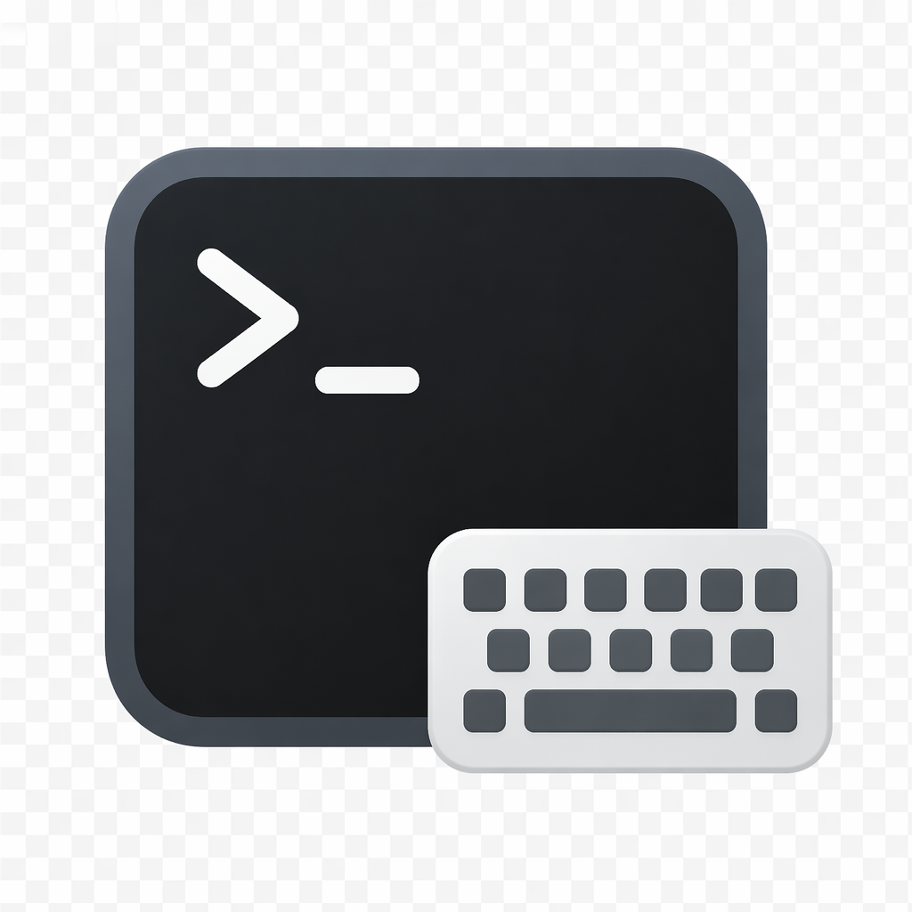

<h1 align="center">TermIMS</h1>

<p align="center"></p>

<p align="center">A lightweight macOS menu bar app that automatically switches input methods based on the focused app — and for terminals, by the running process or tab title.</p>

## Features

- **Per-app input method rules** — switch input methods when the focused app changes.
- **Terminal sub-rules** — match by process name or tab title for Ghostty, Apple Terminal, iTerm2, kitty, WezTerm, Warp. Patterns are case-insensitive substrings; wrap with `/.../` for regex. Inside [herdr](https://github.com/ogulcancelik/herdr), TermIMS reads the focused pane via herdr's local socket so Process Name / Tab Title rules apply per pane.
- **Defaults** — global fallback plus a separate terminal default when no sub-rule matches.
- **Holds when unsure** — if the focused tab can't be identified (say several tabs share a directory and more than one is running something), TermIMS leaves the current input method alone rather than switching on a guess. Arriving from another app still takes the default, since there is no context to keep.
- **Drag-and-drop ordering** — title rules run before process rules; within each type the first match wins.
- **Switch indicator** — brief on-screen overlay showing the new input method, with configurable position.

## How It Works

TermIMS uses the macOS Accessibility API to watch app focus and terminal tab changes. It picks the most precise channel each terminal exposes — AppleScript for Apple Terminal and iTerm2, the bundled CLI for kitty and WezTerm, AX cwd for Ghostty — and falls back to a process-tree + working-directory heuristic otherwise. When the focused host tab is [herdr](https://github.com/ogulcancelik/herdr), it queries herdr's UNIX-socket API for the focused pane (process / agent / title) instead of the host pty tree.

Candidates that disagree — or none at all — mean the focused tab could not be identified. Rather than fall through to the default, TermIMS keeps the current input method whenever you were already in that app, so a wrong switch never interrupts what you are typing.

## Terminal Support

Different terminals expose different signals about the focused tab. Status as of current testing:

| Terminal | Channel | Status | Extra setup |
|---|---|---|---|
| Ghostty | `AXDocument` cwd + process-tree heuristic | Works for tabs in distinct working directories. Tabs sharing a directory are separated by the window title when it names the running program or shows the directory; when it does neither and more than one tab is busy, the match stays undecided and the input method is left alone — add a title rule to resolve it | None |
| Apple Terminal | AppleScript `tty of selected tab` | Works precisely for every tab | First launch macOS prompts for **Automation → Terminal** — accept it |
| kitty | `kitten @ ls` JSON | Works precisely for every tab | Add `allow_remote_control yes` **and** `listen_on unix:/tmp/kitty` to `~/.config/kitty/kitty.conf` and restart kitty. The socket path can be anything — TermIMS reads `listen_on` from the same file. |
| WezTerm | `wezterm cli list` JSON | Works precisely for every tab | None |
| iTerm2 | AppleScript `tty of current session of current window` | Works precisely for every tab and split pane | First launch macOS prompts for **Automation → iTerm**; accept it |
| Warp | Process-tree heuristic | Best-effort. Warp doesn't expose tabs to AX ([#11160](https://github.com/warpdotdev/warp/issues/11160)) and ships no AppleScript ([#3364](https://github.com/warpdotdev/warp/issues/3364)) or query CLI, so when multiple tabs share a cwd disambiguation is brittle. | None |
| Alacritty | Not supported | No AX cwd, no query CLI, title doesn't track the running command. Use tmux inside a single window. | n/a |

On the generic-heuristic path, each tab in its own working directory works out of the box. When tabs share a directory, the window title decides: a title showing that directory means a shell prompt, and a title naming a program picks the tab running it. If neither applies and several tabs are busy, TermIMS holds the current input method instead of guessing — add a **Tab Title** rule to resolve those cases.

### tmux (and other multiplexers)

tmux runs every pane on its own pty under the `tmux` server, which macOS can't see into — the terminal's tty foreground process is always `tmux`, so Process Name rules for commands inside tmux won't match. Push the active pane's command into the title and use a **Tab Title** rule instead:

```tmux
set -g set-titles on
set -g set-titles-string "#{pane_current_command}"
```

### herdr

[herdr](https://github.com/ogulcancelik/herdr) multiplexes agent panes inside one host pty. Its panes are children of the herdr *server*, not of the terminal, so the terminal's process tree only ever shows the `herdr` client — nothing in it reveals which agent is in the focused pane.

TermIMS detects a herdr host tab (its tty runs `herdr`, or the window title mentions it — `herdr`, `herdr session attach work`, `π - herdr` all count) and asks herdr's local socket instead, matching rules against the focused pane's agent label, foreground process names, and pane title.

herdr runs one server per session, each with its own socket and its own single focused pane, so with several sessions open the right one has to be picked first. TermIMS matches the directory the terminal reports for the focused tab against each running client — against the client's focused pane directory, which herdr forwards to the host terminal, and against the directory the client was launched from. If that names exactly one client, its session answers; if it does not, TermIMS holds rather than report a pane from a session you are not looking at.

Switching panes inside herdr produces no macOS focus event — it is one window redrawing — so while a herdr pane is focused TermIMS polls the socket a few times a second and re-resolves when the pane changes.

Typical Process Name patterns inside herdr: `claude`, `cursor`, `pi` (herdr's agent ids). Outside herdr, match the real binary (`claude`, `cursor-agent`, `pi`, …). No extra herdr config is required beyond a running herdr session TermIMS can reach.

## Requirements

- macOS 13.0+
- Accessibility permission (System Settings → Privacy & Security → Accessibility)
- Automation permission for Apple Terminal and/or iTerm2 if you use them (System Settings → Privacy & Security → Automation → TermIMS → ...). macOS prompts on first focus event for each app — just accept.

## Install

### Download

Download `TermIMS.dmg` from the [Releases](https://github.com/cuiko/TermIMS/releases) page, open it, and drag `TermIMS.app` into the `Applications` folder.

### Build from source

Swift Package Manager layout, no Xcode project. `make` wraps `swift build -c release` and bundles the binary into `TermIMS.app` via `Scripts/package-app.sh`.

```sh
git clone https://github.com/cuiko/TermIMS.git
cd TermIMS

make build      # build into build/TermIMS.app
make install    # build + copy to /Applications
make run        # build + install + launch
make dist       # package dist/TermIMS.dmg
```

Requires Swift 6.0+ (Xcode 16). `swift test` runs the unit suite; it covers `TermIMSCore`, the pure matching logic, and needs neither Accessibility permission nor a live terminal.

## Usage

1. Launch TermIMS (or run `make run`).
2. Grant Accessibility permission when prompted.
3. Click the keyboard icon in the menu bar → **Settings**.
4. **General** tab — Set the global default input method, indicator preferences, and optional debug logging.
5. **App Rules** tab — Click **+** to add an app and assign its input method. Drag rows to reorder.
6. **Terminal Rules** tab — Set the terminal default, then add rules to match by process name or tab title. Drag to reorder; title rules are checked before process rules.

### Terminal Rules Example

| Match        | Pattern         | Input Method | Note                              |
|--------------|-----------------|--------------|-----------------------------------|
| Tab Title    | `/^[⠁-⣿✳◐-◓] /` | Pinyin       | Claude Code spinner / idle prefix |
| Tab Title    | `ssh`           | ABC          | Remote sessions                   |
| Process Name | `nvim`          | ABC          |                                   |

Patterns are case-insensitive substrings by default. Wrap with slashes (`/pattern/`, append `i` for case-insensitive) to use a regex.

Short patterns match more than they look like they do. `pi` is a substring of `PixPin`, `spindump` and `MTLCompilerService`; `agent` matches `ssh-agent` and most of macOS's `*Agent` daemons; `cursor` matches `CursorUIViewService`. Anchor them when the name is short or common — `/^pi(-|$)/` still catches `pi` and `pi-coding-agent` without the rest.

#### Why the Claude rule uses a title regex

`Process Name = claude` can't always pin focus to one tty when several Ghostty/Warp tabs share a working directory, so the match may stay undecided. The window title is per-tab and does not have that problem.

Claude Code rewrites the terminal title while it works, using more than one spinner family: Braille (`⠂ <summary>`, U+2801–U+28FF), the `✳ <summary>` idle marker, and circle quadrants (`◐ <summary>`, U+25D0–U+25D3). A class covering only the first two silently stops matching whenever the third is on screen, so `/^[⠁-⣿✳◐-◓] /` spans all three. The same trick works for any tool with a distinctive title prefix.

#### Process names vs. user-typed commands

Process Name rules match the kernel-reported executable (`kp_proc.p_comm`), not the typed command. Many wrappers (`mole`, `cargo`, `bundle`, `mise`, `asdf`, …) `exec` into a different binary, so `mole analyze` shows up as `analyze-go`. Match the underlying binary, or use a Tab Title rule (shell `preexec` hooks usually put the typed command in the title).

For Node / Bun / Deno (and similar), TermIMS also peels the script basename out of argv when the runtime itself is the foreground process, and respects a rewritten argv0 / `process.title` (e.g. `pi`) when there is no script path. Generic entrypoints like `cli` / `index` under `dist` / `bin` climb one more path segment; version-like directories are skipped so argv0 can win.

## Troubleshooting

When a tab switches to the wrong input method — or to none — ask the app what it saw:

```sh
/Applications/TermIMS.app/Contents/MacOS/TermIMS diagnose
```

It prints, as JSON, every signal the matcher consumed for the frontmost app: the window title, the reported directory, the candidate surfaces and their processes, whether herdr was consulted, the enabled rules, and the input source it resolved — both for arriving from another app and for already being inside it, which is where an undecided match holds.

A tab can also be replayed without focusing it, which is the only way to inspect a tab other than the one you are working in:

```sh
TermIMS diagnose --bid com.mitchellh.ghostty --title "◐ some task" --cwd ~/project
```

For herdr specifically, `TermIMS herdr-probe [directory]` reports which session a tab in that directory resolves to and what its focused pane is running. It touches no Accessibility API, so it runs from a plain `swift build` without installing anything.

Settings → General → Debug writes the same decisions to `~/Library/Logs/TermIMS/termims.log` as they happen.

## Uninstall

Trashing `TermIMS.app` only removes the bundle. Run the bundled uninstall script to also quit the app, unload the launch agent, and delete the UserDefaults plist, log directory, and caches:

```sh
curl -fsSL https://raw.githubusercontent.com/cuiko/TermIMS/main/uninstall.sh | bash
```

macOS doesn't let scripts revoke privacy grants — remove TermIMS from **System Settings → Privacy & Security → Accessibility** (and **→ Automation** if you used Apple Terminal / iTerm2) by hand.

---

Inspired by [KeyboardHolder](https://github.com/leaves615/KeyboardHolder).

## License

[MIT](LICENSE)
